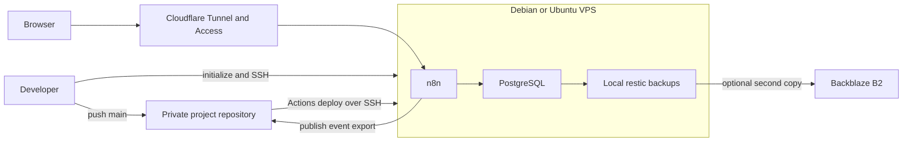

# n8n-core-setup

Run self-hosted n8n on one VPS, with Cloudflare ingress, encrypted secrets,
GitHub Actions deployment, and encrypted database backups.
Create one private repository per project and initialize it in place.

This template is for developers comfortable with a terminal and Docker.
You control the server, workflow code, credentials, and recovery keys.

## Supported environment

| Part | Supported |
| --- | --- |
| Developer machine | macOS |
| Deployment host | Debian or Ubuntu, x86, root SSH access |
| Server creation | DigitalOcean or Hetzner through the wizard |
| Ingress | A domain using Cloudflare DNS, Tunnel, and Access |
| Automation | GitHub Actions; deployment branch `main` |

Everything outside this boundary is unsupported, including other developer
operating systems, ARM servers, other providers, and existing-server setup.

## How it fits together



## What you get

- A Docker Compose stack: n8n, PostgreSQL, and cloudflared, with image digests pinned.
- Loopback-only n8n port publishing and Cloudflare Access for the editor.
- Public webhook paths; each receiving workflow must authenticate its requests.
- SOPS and age encryption for committed secrets, with two GitHub Actions secrets.
- Workflow JSON deployment from Git and export of UI publish events back to Git.
- Nightly local restic backups; optional Backblaze B2 offsite copies.
- A Global Error Handler, optional email alerts, and a Health Ping workflow.
- A TypeScript custom-node and credential example in [the node package](n8n/custom-nodes/).
- Local unit checks and secret-free CI for pushes and pull requests.

## Prerequisites and costs

| Requirement | Prepare before setup | Cost basis |
| --- | --- | --- |
| VPS account | DigitalOcean API token or Hetzner Cloud API token | Approximate monthly quote from the provider API in the wizard; confirm before creation |
| Domain and Cloudflare | Domain on Cloudflare DNS and an API token | Domain renewal and applicable account plan; check your providers |
| GitHub | A private repo (existing or wizard-created), Actions, and a repository-scoped PAT | Your GitHub plan and Actions usage |
| Optional B2 | Application key; the wizard chooses a bucket name | Storage and usage; see [Backblaze pricing](https://www.backblaze.com/cloud-storage/pricing) |
| Optional notifications | Resend sender/API key; healthchecks.io read-write API key | Applicable service plans and usage |

Provider price sources: [DigitalOcean Droplets](https://www.digitalocean.com/pricing/droplets)
and [Hetzner Cloud](https://www.hetzner.com/cloud/).
There is no fixed monthly total: server size, location, backups, and usage vary.
The wizard marks server sizes with at least 2 GB RAM as recommended.
Database credentials are set automatically, with a generated password. Optional B2
backup names start at `<PROJECT_NAME>-backups`; first-run name collisions retry
with a short random suffix. Disk alerts use 85% and 95% used. Saved values stay on
reruns. The Resend sender defaults to `alerts@` on the selected domain; review it
when configuring email alerts.

Run `npm run check-prerequisites` to check the local tools independently, or
`bash scripts/check-prerequisites.sh` if npm is not installed yet. The same
check runs first on every initialization, including `--hard-reset`, before reading environment files or prompting.

| Required executable | Used for | macOS install command |
| --- | --- | --- |
| `git` >=2.28 | Repository setup and synchronization | `brew install git` |
| `gh` >=2.40 | GitHub repository privacy and setup | `brew install gh` |
| `curl` >=7.76 | Provider and service API requests | `brew install curl` |
| `jq` | JSON processing | `brew install jq` |
| `openssl` | Secret generation | `brew install openssl` |
| `rsync` | Workflow downloads | `brew install rsync` |
| `sops` | Secret encryption and decryption | `brew install sops` |
| `ssh`, `scp`, `ssh-keygen`, `ssh-keyscan` | VPS commands, uploads, SSH keys and host verification | `brew install openssh` |
| `node` >=14.17, `npm` >=7 | Custom-node dependency installation and build | `brew install node` |
| `age-keygen` | Encryption key generation | `brew install age` |

The check reports every missing or outdated tool with its purpose and install or
upgrade command, then one combined Homebrew install command with each package
listed once. If `brew` is absent, it first points to [Homebrew](https://brew.sh).
Homebrew itself is not needed once the required tools are available. The checker
never installs tools. When `gh` is present, it also runs `gh auth status --active`
and reports login or connectivity failures alongside missing tools. Run
`gh auth login`, choose GitHub.com, and ensure `repo` and `workflow` scopes;
for an existing login, run `gh auth refresh -s repo,workflow`.
The same report covers unfinished Git operations, unmerged paths and index locks,
write probes in the project and temporary directories, readable env/config files,
age-directory creation access, a writable age `keys.txt` and a usable interactive terminal. Follow `git status` to finish
or abort an operation; wait for another Git process and never delete its lock.
Re-run `npm run initialize` after resolving the reported problems.

Before creating a billable server, setup checks a readable SSH private key usable
without a passphrase, builds custom nodes locally, tests a push with `--dry-run`,
and validates the PAT against the selected repository and Actions. With no remotes,
submitting the repository name creates it as private, without another confirmation.
The PAT check confirms access; Contents write is confirmed by the first workflow
publish from the VPS. Provider keys must match the selected private key, including
keys stored outside `~/.ssh`.
Provider menus offer x86 types/sizes first, then their available locations and prices.
Review the summary: Enter at `Create this server? [Y/n/r]` creates; `n` aborts and
`r` restarts selection. A definite API rejection refreshes selection; an uncertain
response stops for dashboard reconciliation. Availability can change before creation.

Enter a city such as Berlin or New York, or a zone such as Europe/Berlin, for workflow
schedules and server jobs. The default is this machine's timezone, or UTC. Hidden
inputs show asterisks; Backspace removes a character.

Optional tools never block setup: `pbcopy`, `xclip`, or `xsel` enable clipboard
copying (otherwise copy manually); `afplay` or `osascript` enable sound cues
(otherwise the terminal bell is used); `open` launches the deploy watcher in a
Terminal window (otherwise it runs without a window). A note appears only when
all alternatives for a feature are absent.

Base macOS command-line utilities and Bash 3.2 are assumed. Docker, Python, restic,
and rclone are used on the VPS and are not local initialization prerequisites.
On other developer platforms the checker reports the unsupported boundary and
suggests `apt-get install` packages where known; this does not add platform support.
Unit checks additionally use Python 3; see [contributing](CONTRIBUTING.md).

## Quickstart

1. Open [the GitHub template](https://github.com/lipchey/n8n-core-setup).
   Select **Use this template → Create a new repository**, and make it private.
2. Clone your new repository, then enter its directory:

   ```bash
   git clone git@github.com:YOUR_ACCOUNT/YOUR_PROJECT.git
   cd YOUR_PROJECT
   ```

3. Confirm you are on `main` and the push remote points to your new repository.
   Set your Git identity and authenticate the GitHub CLI before setup.
4. Prepare the tokens and SSH key listed in [the setup walkthrough](docs/setup.md).
5. Run the interactive wizard:

   ```bash
   npm run initialize
   ```

Alternatively, copy the template files without `.git` into a new directory outside
any other Git repository, enter it, and run `npm run initialize`. With no remotes,
the wizard offers to create your private GitHub repository. Set your Git identity
first and authenticate `gh` with `repo` and `workflow` scopes
(`gh auth login --scopes repo,workflow`).
The default destination is your GitHub login and project name; you can choose
another `owner/repo`. Submitting the name creates the private repository immediately;
there is no separate creation confirmation.

The wizard confirms the private GitHub destination before creating a provider
server, then configures Cloudflare, verifies the ed25519 host key before SSH,
installs the stack, and asks you to create the n8n owner account in the browser
with your own email and a strong password saved in your password manager.
Then create an API key under Settings → API and paste it into the hidden prompt;
the key must pass an API probe, and a valid saved key skips these steps on reruns.
It configures GitHub secrets, initializes backups, encrypts local secrets,
then commits and pushes initialization files to trigger deployment.
If no run appears after two minutes of successful API polling, it dispatches
the deploy automatically once and follows that run. API failures report their
HTTP status and stop the wait without dispatching.
After deployment it offers MCP configuration and runs live environment checks.
There is no pause for reviewing test results before encryption.
First-run image refresh defaults to yes and selects the numeric n8n tag matching
Docker Hub's `stable` digest; it stops that lookup if stable cannot be resolved.

Save an offline copy of the generated age private key when prompted.
Keep the original n8n encryption key and backup password recoverable too.
Local backups share the VPS: losing that server can lose both data and backups.

## Repository safety

Initialization refuses the public template as a push destination, a
non-GitHub push remote, push URLs targeting different repositories, and a
configured `GITHUB_REPO` that disagrees with the push remote.
The repository prompt defaults to that remote's owner/repo.
When no remotes exist, the wizard can create a private repository without pushing.
An unborn repository gets a local root commit of the non-ignored tree; existing
commits are preserved. Upload waits until secrets are encrypted later in setup.
A missing selected remote alongside other remotes, a directory inside another
Git repository, or `--hard-reset` without a remote stops initialization.

Only trusted people should edit this instance or its workflows.
`N8N_BLOCK_ENV_ACCESS_IN_NODE=false` allows workflow expressions to read
environment variables, including secrets passed to n8n.
Read [the security contract](SECURITY.md) before deploying.

## Working with your project

Humans can edit in the n8n UI and publish; the VPS checks for publish events
every minute and exports workflow JSON to your repository.
Pull those commits before making local edits.
Agents author repository JSON and use MCP for inspection only.
Pushing to `main` deploys runtime changes; documentation-only changes skip deployment.

| Need | Read |
| --- | --- |
| Tokens, first run, reruns, recommended answers | [Setup walkthrough](docs/setup.md) |
| Current step order and prompt defaults | [Generated initialization tables](docs/setup-prompts.md) |
| Files, keys, domain modes, settings | [Configuration reference](docs/configuration.md) |
| Deploys, backups, restore, recovery, upgrades | [Operations](docs/operations.md) |
| Template, project, overlay, deployment host | [Glossary](docs/glossary.md) |
| Workflow JSON authoring rules | [Workflow rules](docs/workflow-rules.md) |
| Checks and patches | [Contributing](CONTRIBUTING.md) |

## Licence

The [MIT licence](LICENSE) covers this repository's code only.
n8n itself is distributed under [its own licence](https://github.com/n8n-io/n8n/blob/master/LICENSE.md).
